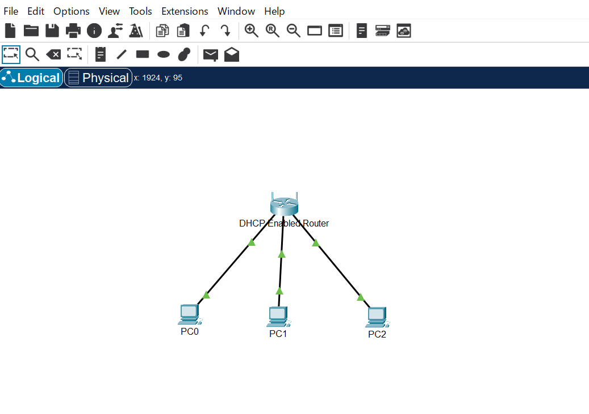
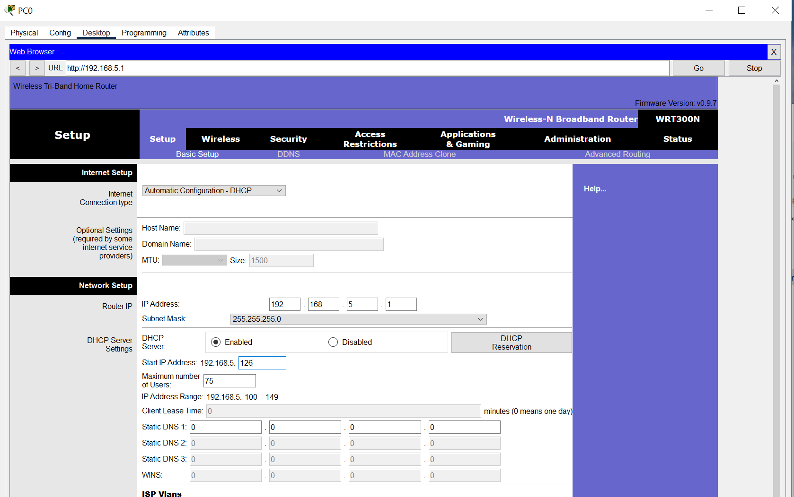
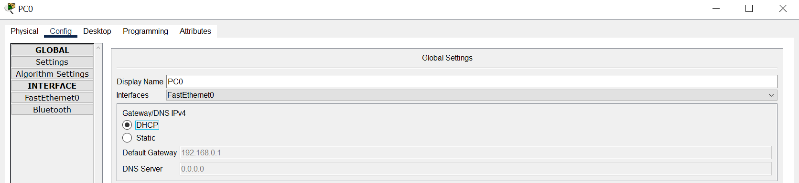
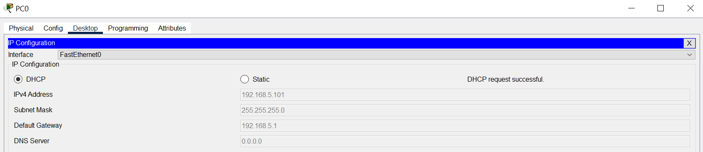
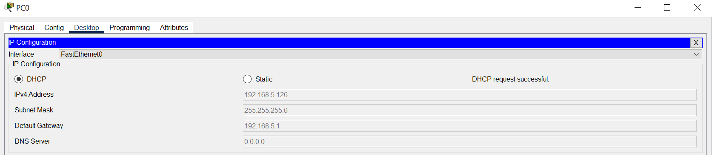
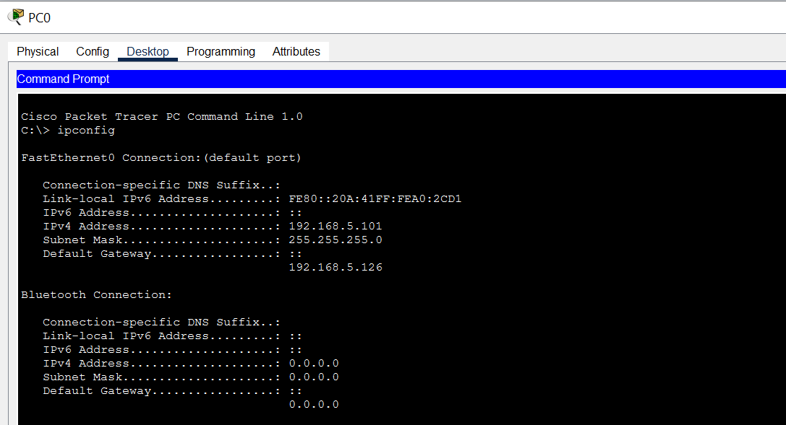
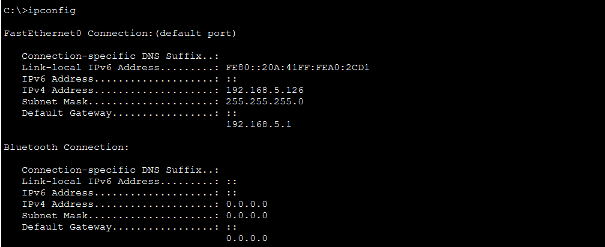
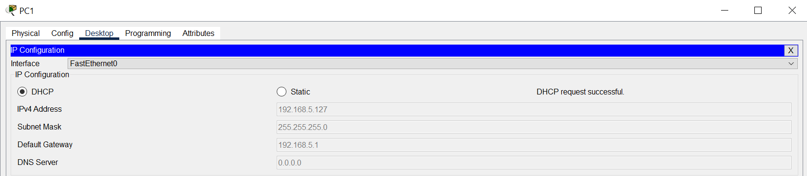
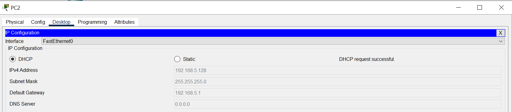
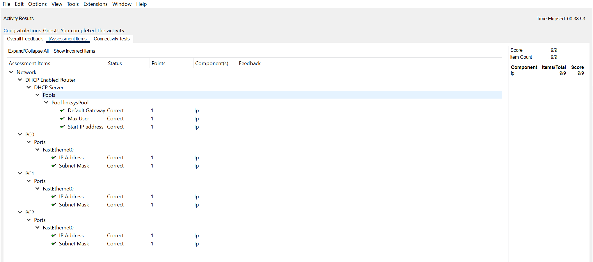

# Packet Tracer — Configure DHCP on a Wireless Router

## Overview

This lab demonstrates how to configure a wireless router's IPv4 address and DHCP settings in Cisco Packet Tracer. Three PCs are connected to the router and configured to obtain their network settings automatically through DHCP.

## Objectives

- Connect three PCs to a wireless router using Ethernet cables.
- Examine the router's default DHCP configuration.
- Change the router's LAN IP address.
- Configure the DHCP address pool.
- Configure clients to obtain IPv4 settings automatically.
- Verify connectivity between the router and the PCs.

## Network Topology

The network consists of one wireless router and three PCs connected through Ethernet.

**Devices:**
- Wireless Router
- PC0
- PC1
- PC2



## Configuration

### 1. Router LAN Configuration

The router's LAN IP address is changed to:

- **IP Address:** `192.168.5.1`
- **Subnet Mask:** `255.255.255.0`

### 2. DHCP Configuration

The DHCP server is configured with the following parameters:

- **Starting IP Address:** `192.168.5.126`
- **Maximum Number of Users:** `75`
- **Address Assignment:** Automatic through DHCP

These settings allow the router to dynamically assign IPv4 addresses to connected clients.



### 3. Client Configuration

PC0, PC1, and PC2 are configured to obtain their IPv4 settings automatically using DHCP.

The assigned IP addresses can be verified with:

```text
ipconfig
```


## Connectivity Verification

Connectivity is tested from PC2 using the following commands:

```text
ipconfig
ping 192.168.5.1
ping 192.168.5.126
ping 192.168.5.127
```

The ping tests check connectivity to:
- The wireless router
- PC0
- PC1

The results are documented in the screenshots.


## Key Networking Concepts

### DHCP

Dynamic Host Configuration Protocol (DHCP) automatically assigns IP configuration to clients, reducing the need for manual configuration.

### Default Gateway

The default gateway is the router's LAN address. A client uses it to reach destinations outside its local subnet.

### IPv4 Address Pool

The DHCP address pool defines the range from which the router assigns addresses to clients.

### Connectivity Troubleshooting

The `ipconfig` command helps verify client configuration, while `ping` tests IP connectivity between devices.

## Screenshots and Verification

### 1. Network Topology

The network topology includes a wireless router and three PCs connected through Ethernet cables.


### 2. Default DHCP Settings

This screenshot shows the default DHCP configuration on the wireless router, including the DHCP server status, starting IP address, and available address range.



### 3. Router IP Configuration

This screenshot documents the updated LAN IP address of the wireless router, configured as `192.168.5.1`.



### 4. DHCP Range Configuration

This screenshot shows the updated DHCP address pool, with a starting IP address of `192.168.5.126` and a maximum of 75 users.


### 5. DHCP Lease Renewal

This screenshot documents the process of renewing the client's IP configuration after the router's LAN address and DHCP settings were changed.



### 6. DHCP Verification

The `ipconfig` command is used to verify the IPv4 address, subnet mask, and default gateway assigned to a client through DHCP.



### 7. PC0 IP Configuration

This screenshot shows the network configuration assigned to PC0 through DHCP.



### 8. PC1 IP Configuration

This screenshot shows the network configuration assigned to PC1 through DHCP.



### 9. PC2 IP Configuration

This screenshot shows the network configuration assigned to PC2 through DHCP.



### 10. Connectivity Test to the Router

The `ping` command is used to verify connectivity between PC2 and the wireless router at `192.168.5.1`.


### 11. Local Connectivity Test — PC0

This screenshot documents the connectivity test from PC2 to PC0 at `192.168.5.126` using the `ping` command.


### 12. Local Connectivity Test — PC1

This screenshot documents the connectivity test from PC2 to PC1 at `192.168.5.127` using the `ping` command.


### 13. Final Lab Result

This screenshot provides additional evidence of the completed lab, including the router configuration, client IP settings, and connectivity verification.



## SOC Analyst L1 Relevance

Understanding DHCP and IPv4 configuration helps a SOC Analyst L1 investigate basic network connectivity issues and recognize potentially suspicious address-assignment activity.

Relevant skills include:

- Reading IPv4 configuration
- Identifying the default gateway
- Understanding DHCP address allocation
- Performing basic connectivity checks
- Collecting and documenting technical evidence

## Tools

- Cisco Packet Tracer
- DHCP
- IPv4
- Windows Command Prompt

## What I Learned

- How to modify a router's LAN IP address.
- How to configure a DHCP address pool.
- How to configure clients for automatic IPv4 addressing.
- How to verify network connectivity using `ipconfig` and `ping`.

## Disclaimer

This project was completed in a simulated Cisco Packet Tracer environment for educational purposes.
