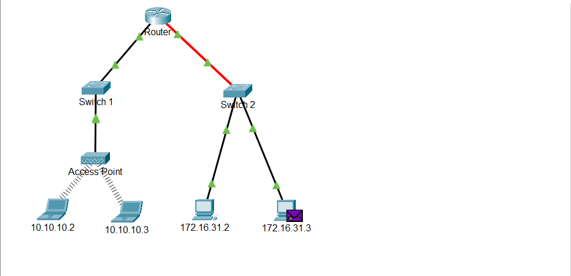
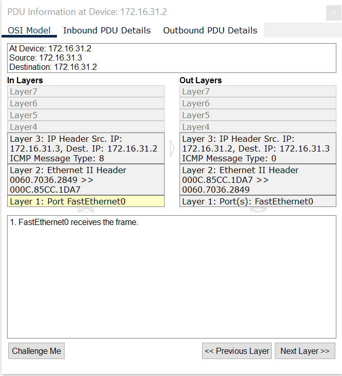

### Identify MAC and IP Addresses

## Overview
Part 1: Gather PDU Information for a Local Network Communication
Part 2: Gather PDU Information for a Remote Network Communication

In this Packet Tracer activity, I inspected Ethernet frames and IP packets at different points in the network as they travel from source to destination. You will focus on the way that the MAC and IP addresses change depending on the destination (local or remote) and the place where the PDUs are captured.

## Network Topology

The network consists of one router,2 switch,2 PCs,access point for 2 laptops.

**Devices:**
- Router
- 2 switch
- PC 172.16.31.2
- PC 172.16.31.2
- laptop 10.10.10.2
- laptop 10.10.10.3

 

### Part 1: Gather PDU Information for a Local Network Communication

In this part, I studied how a device on a local network does not need a default gateway to communicate with another device on the same local network.

ping 172.16.31.2 to 172.16.31.3

How does the addressing differ, and why?

The MAC addresses may change as the PDU passes through different network devices, because MAC addresses are used for local Ethernet delivery. The source and destination IP addresses remain the same when the packet travels within the same local network. Since the destination is on the same subnet, the source device can communicate directly without using a default gateway.

### Part 2: Gather PDU Information for a Remote Network Communication

To communicate with remote networks, a gateway device is necessary. The gateway device connects two or more networks together. In this part,I learned  the process that takes place when one device communicates with another device that is on a remote network. Pay close attention to the MAC addresses used.

