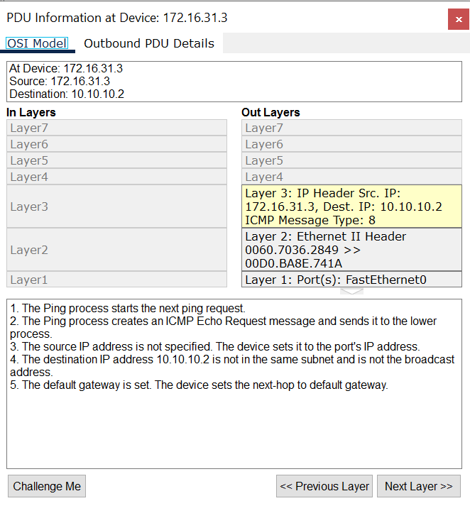
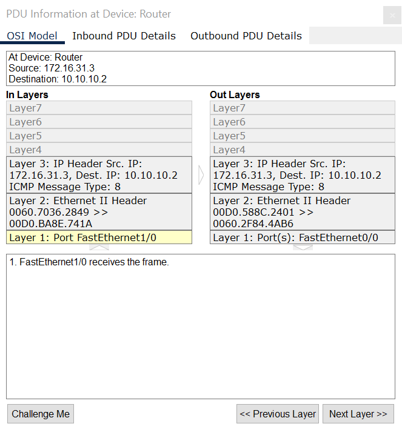
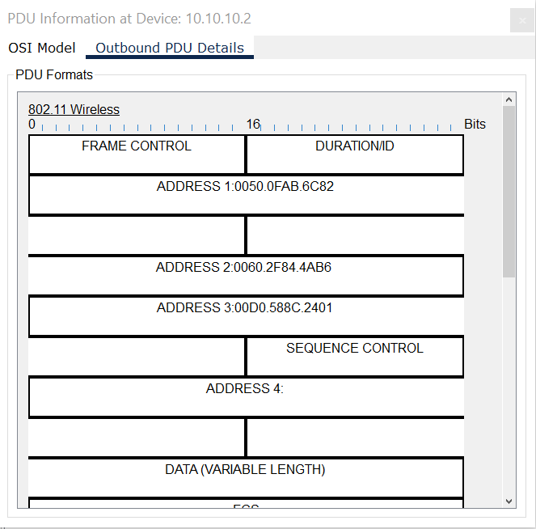
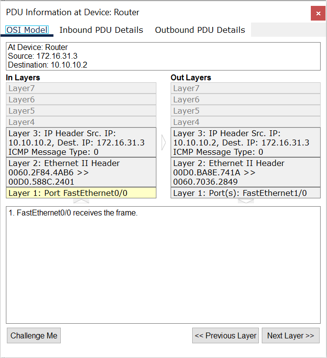
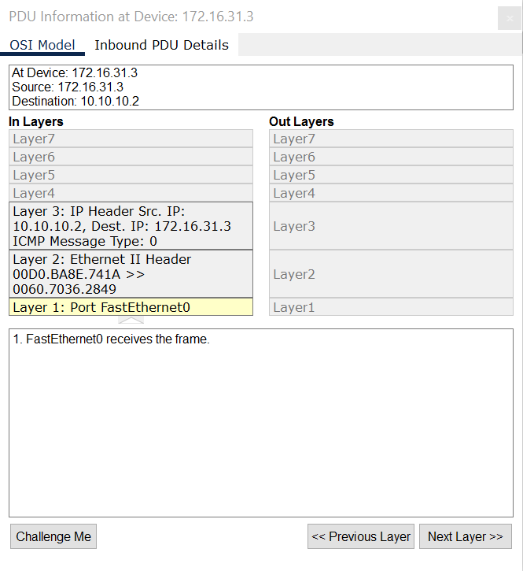
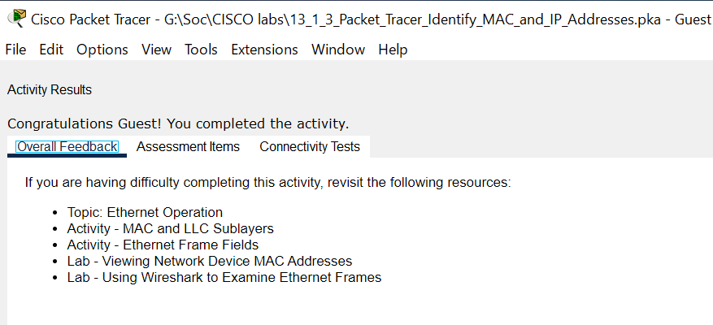

# Identify MAC and IP Addresses

## Overview

This Packet Tracer activity focuses on identifying MAC and IP addresses during local and remote network communication.

The lab is divided into two parts:

- **Part 1:** Gather PDU Information for a Local Network Communication
- **Part 2:** Gather PDU Information for a Remote Network Communication

I inspected Ethernet frames and IP packets at different points in the network to understand how MAC and IP addressing works during packet delivery.

## Network Topology

The network consists of one router, two switches, two PCs, one wireless access point, and two laptops.

**Devices:**
- 1 Router
- 2 Switches
- PC: `172.16.31.2`
- PC: `172.16.31.3`
- Laptop: `10.10.10.2`
- Laptop: `10.10.10.3`
- 1 Wireless Access Point

### Part 1: Gather PDU Information for a Local Network Communication

In this part, I investigated how two devices communicate within the same local network.

When the destination device belongs to the same subnet, the source device can communicate directly without sending traffic through the default gateway.

The Ethernet frame contains the source and destination MAC addresses of the communicating devices. Switches forward the frame without changing these addresses.

**Connectivity test:** `172.16.31.3` → `172.16.31.2`

**Key observation:**

For local communication, the source device sends the Ethernet frame directly to the destination device's MAC address. The source and destination IP addresses identify the communicating hosts and remain unchanged during normal local delivery.

### Part 2: Gather PDU Information for a Remote Network Communication

In this part, I investigated how a device communicates with a host located on a different network.

When the destination IP address belongs to a remote subnet, the source device sends the Ethernet frame to its default gateway. The router then forwards the IP packet toward the destination network.

At each routed Ethernet segment, the router creates a new Ethernet frame with new source and destination MAC addresses. The source and destination IP addresses normally remain unchanged when NAT is not used.

**Connectivity test:** `172.16.31.3` → `10.10.10.2`

## Screenshots and Verification

### 1. Outbound PDU from PC `172.16.31.3`

The source PC sends the frame to the router's MAC address, using the default gateway to reach the remote network.

### 2. Outbound PDU from the Router

The router forwards the packet using a new Ethernet frame. The source and destination MAC addresses are different from those in the original frame.

### 3. Packet Arrival at Laptop `10.10.10.2`

The destination laptop receives the packet on the remote network.

### 4. Return Packet from Laptop `10.10.10.2`

The destination laptop sends the response toward its default gateway.

### 5. Return Packet Arrival at PC `172.16.31.3`

The router forwards the response to the original PC using a new Ethernet frame addressed to the PC's MAC address.

### 6. Lab Completion

## Key Networking Concepts

- **MAC Address:** A Layer 2 address used for communication within a local Ethernet segment.
- **IP Address:** A Layer 3 address used to identify source and destination hosts across networks.
- **Default Gateway:** The router interface used to forward traffic to remote networks.
- **Ethernet Frame:** The Layer 2 data unit containing source and destination MAC addresses.
- **IP Packet:** The Layer 3 data unit containing source and destination IP addresses.
- **Routing:** The process of forwarding IP packets between different networks.

## SOC Analyst L1 Relevance

Understanding MAC and IP addressing is important for basic network traffic analysis and incident investigation.

This lab demonstrates how to:
- Identify source and destination hosts.
- Distinguish local communication from remote communication.
- Recognize the role of a default gateway.
- Understand MAC address changes during routing.
- Interpret packet information in network traffic analysis.

## What I Learned

- How to identify MAC and IP addresses in Packet Tracer PDUs.
- Why devices in the same subnet can communicate without a default gateway.
- How a router forwards packets between different networks.
- Why MAC addresses change at each routed Ethernet segment while IP addresses normally remain the same.

## Tools

- Cisco Packet Tracer

## Disclaimer

This lab was completed in a simulated network environment using Cisco Packet Tracer. All IP and MAC addresses are part of the lab topology.
