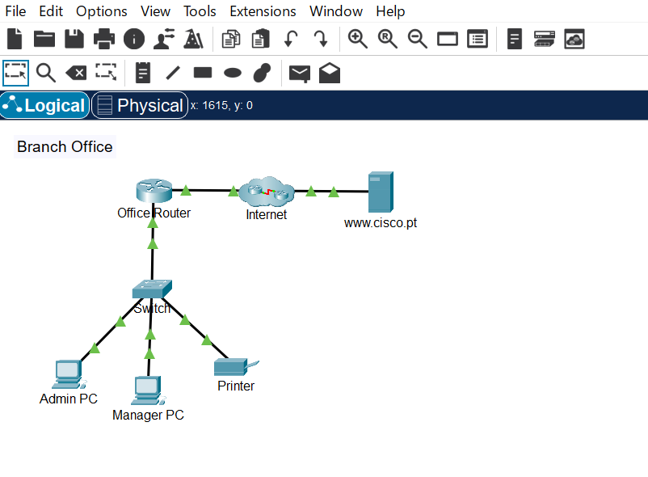
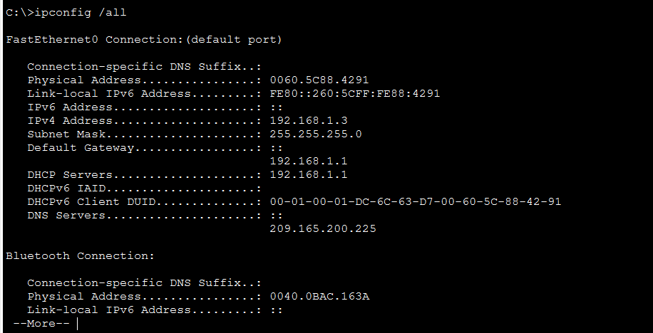
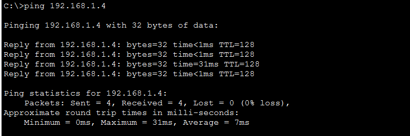
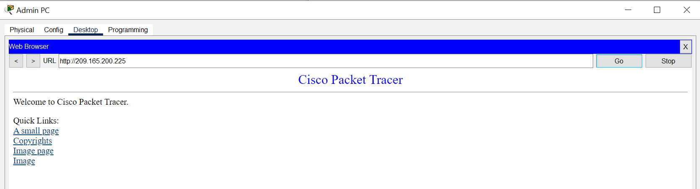
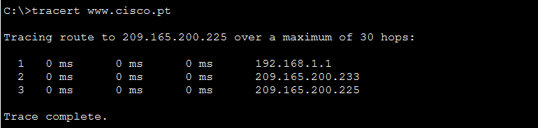
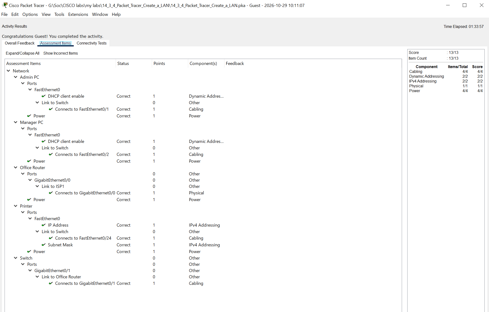

# Connect and Configure a LAN — Cisco Packet Tracer

## Overview

This lab focuses on building and configuring a small office LAN using Cisco Packet Tracer.

The objective is to connect network devices, configure IPv4 addressing, verify connectivity, and use basic networking commands to troubleshoot network communication.

## Objectives

- Connect end devices and network devices.
- Configure end devices to obtain IPv4 addresses through DHCP.
- Configure a static IPv4 address for a printer.
- Verify local network connectivity using `ping`.
- Inspect network settings using `ipconfig` and `ipconfig /all`.
- Trace the path to a remote server using `tracert`.

## Network Components

- Office router
- Network switch
- Admin PC
- Manager PC
- Network printer
- Internet server

## Key Networking Concepts

### IPv4 Addressing

Each device requires an appropriate IP configuration to communicate on the network.

Devices in the same subnet can communicate directly at Layer 2 when the required local addressing and connectivity are configured correctly.

### DHCP

Dynamic Host Configuration Protocol automatically provides clients with network configuration, including an IP address, subnet mask, default gateway, and DNS server information.

### Default Gateway

The default gateway allows a host to send traffic to destinations outside its local subnet.

### DNS

Domain Name System resolves domain names to IP addresses. A DNS resolution problem can prevent access to a website by name even when access by IP address works.

### Network Troubleshooting

- `ping` checks whether a destination responds to ICMP echo requests.
- `ipconfig` displays basic IP configuration.
- `ipconfig /all` displays detailed network adapter information.
- `tracert` helps identify the network path toward a destination.

## Verification

The following checks are part of the lab:

- Verify that network links are active.
- Confirm that the PCs receive IPv4 configuration through DHCP.
- Check connectivity between the PCs and the printer using `ping`.
- Access the remote server by IP address and URL.
- Inspect network configuration with `ipconfig` and `ipconfig /all`.
- Use `tracert` to examine the route to the remote server.

## Screenshots and Verification

### 1. Network Topology

The network topology includes the office router, switch, Admin PC, Manager PC, printer, and internet connection.

### 2. IPv4 Configuration

This screenshot shows the IP configuration of an end device, including its IPv4 address, subnet mask, default gateway, and DNS settings.

### 3. Local Connectivity Test

This screenshot documents the connectivity test between a PC and the printer using the `ping` command.

### 4. Internet Connectivity

This screenshot documents the test of access to the remote server.

### 5. Traceroute Analysis

The `tracert` command is used to examine the network path toward the remote server and identify responding intermediate hops.

### 6. Final Lab Result

This screenshot provides additional evidence of the completed lab.

## SOC Analyst L1 Relevance

Understanding basic network configuration is important for SOC analysts investigating network-related alerts.

These skills help an analyst:

- Understand source and destination IP addresses.
- Recognize the role of DHCP and DNS.
- Interpret basic connectivity problems.
- Understand the function of a default gateway.
- Perform initial network troubleshooting before escalating an incident.

## What I Learned

This lab reinforces the relationship between IPv4 addressing, DHCP, DNS, default gateways, and network connectivity.

It also provides practical experience using basic command-line networking tools.

## Tools

- Cisco Packet Tracer
- Cisco Networking Academy learning materials

## Disclaimer

This project documents my own learning and lab work. Cisco and Cisco Networking Academy are the respective owners of their trademarks and course materials.
