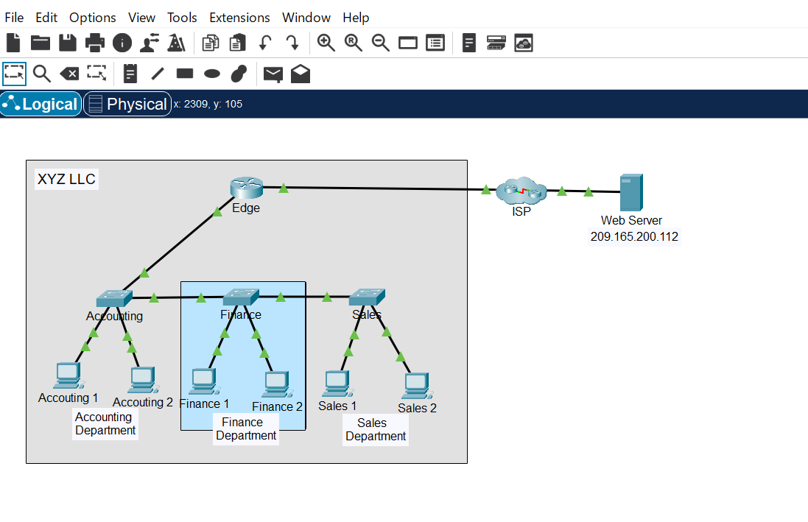

### Observe Traffic Flow in a Routed Network
## Objectives
Part 1: Observe Traffic Flow in an Unrouted LAN
Part 2: Reconfigure the Network to Route Between LANs
Part 3: Observe Traffic Flow in the Routed Network

### Scenario

The XYZ network consists of about 150 devices that are connected to a LAN. The LAN is configured on a single IPv4 network. Hosts in different departments are connect to switches which are then connected to the Edge router. The router only routes traffic between the LAN and the internet, represented by the ISP cloud. Because only one IP network is used in the LAN, all departments are on the same network.

I worked of how having multiple routed networks in a business can improve network efficiency.

