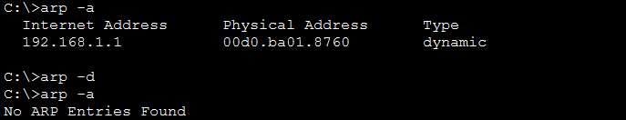

### Observe Traffic Flow in a Routed Network
## Objectives
Part 1: Observe Traffic Flow in an Unrouted LAN
Part 2: Reconfigure the Network to Route Between LANs
Part 3: Observe Traffic Flow in the Routed Network

### Scenario

The XYZ network consists of about 150 devices that are connected to a LAN. The LAN is configured on a single IPv4 network. Hosts in different departments are connect to switches which are then connected to the Edge router. The router only routes traffic between the LAN and the internet, represented by the ISP cloud. Because only one IP network is used in the LAN, all departments are on the same network.

I worked of how having multiple routed networks in a business can improve network efficiency.

### Part 1: Observe Traffic Flow in an Unrouted LAN

## The ARP process constructs a request for the target IP address»

Check and delete MAC addresses in the ARP cache by  the arp -a command. There should be no MAC addresses in the ARP cache. If there are entries in the ARP cache, use the arp -d command to delete them.

Зачем очищать кэш перед симуляцией: Чтобы увидеть ARP Request (широковещательный кадр / Broadcast), который ПК вынужден отправить, когда не знает MAC-адреса назначения.

SOC-перспектива: В реальной сети злоумышленники могут отправлять поддельные ARP-ответы (ARP Spoofing / Poisoning), перехватывая трафик между жертвой и шлюзом. Аналитики SOC отслеживают аномальные изменения ARP-таблиц для обнаружения атак класса Man-in-the-Middle (MitM).

## Step 2: Observe traffic flow in the network

Ping  from Sales 2, and then enter the ping command followed by the IP address of Sales 1. 

The ARP process constructs a request for the target IP address»

Входящий кадр (In Layers — слева):Source: Sales 2 (192.168.1.4)   Destination: Broadcast   Ethernet II Header: от MAC-адреса Sales 2 (00E0.8FA9.B373) к широковещательному FFFF.FFFF.FFFF.   ARP Packet: Src. IP: 192.168.1.4, Dest. IP: 192.168.1.3 — это широковещательный ARP Request от Sales 2, который спрашивает: «У кого IP 192.168.1.3? Сообщите ваш MAC-адрес».   Исходящий кадр (Out Layers — справа):Ethernet II Header: от MAC-адреса Sales 1 (0060.70EC.83C3) напрямую к MAC-адресу Sales 2 (00E0.8FA9.B373).   ARP Packet: Src. IP: 192.168.1.3, Dest. IP: 192.168.1.4 — это ARP Reply (Unicast-ответ), в котором Sales 1 сообщает свой физический адрес.   Этот скриншот — доказательство успешного обмена ARP-запросом и ответом перед началом передачи пакетов ICMP.

2. Why is the destination MAC address the broadcast address?
Ответ: Потому что в ARP-кэше Sales 2 изначально отсутствовала запись с MAC-адресом Sales 1. Чтобы узнать физический адрес назначения, Sales 2 должен отправить широковещательный запрос (Broadcast ARP Request) ко всем устройствам в том же широковещательном домене (L2 domain).

3. Which hosts and other types of devices needed to process the ARP request packets?
Ответ:

Все коммутаторы (Switches): Они принимают широковещательный кадр на один порт и лавинно рассылают (flood) его во все остальные активные порты.

Все конечные хосты (Hosts) и шлюз (Router): Все устройства в этой локальной сети (включая интерфейс Edge-маршрутизатора) получают этот ARP-запрос на Layer 2 и обрабатывают его на Layer 3. Однако только хост с совпадающим IP-адресом (192.168.1.3 — Sales 1) формирует ARP-ответ (ARP Reply), а остальные устройства просто сбрасывают этот пакет.

4. What is the impact of this on efficient operation of the network as it is currently configured?
Ответ: Поскольку вся сеть компании (около 150 устройств) находится в одном несегментированном IPv4-пространстве (одном широковещательном домене), каждый ARP-запрос заставляет абсолютно каждое устройство прерывать работу своего сетевого стека для проверки IP-адреса. Это создает избыточный широковещательный шторм трафика (Broadcast Overhead), тратит вычислительные ресурсы хостов и снижает производительность сети. Для решения этой проблемы сеть необходимо разделить на VLAN / отдельные подсети.

5. What type of PDU is this? (New PDU at Sales 2)
Ответ: Это ICMP PDU (сообщение ICMP Echo Request / ping)
